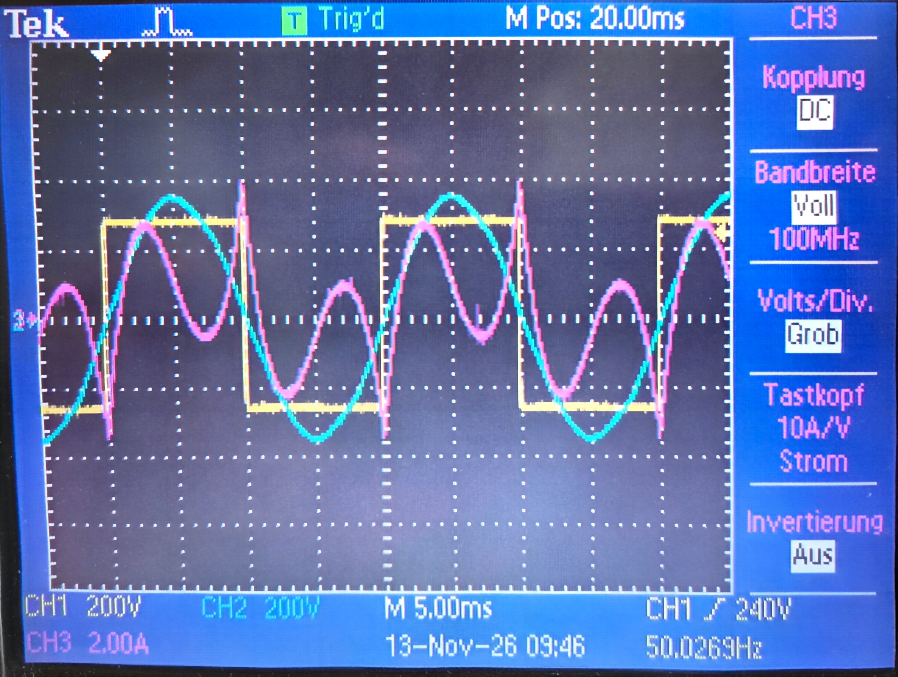
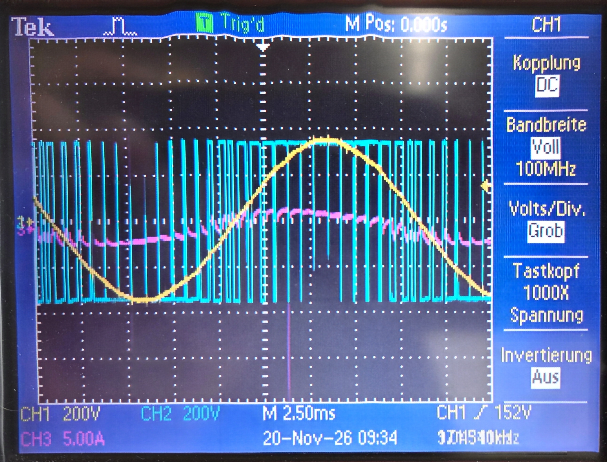
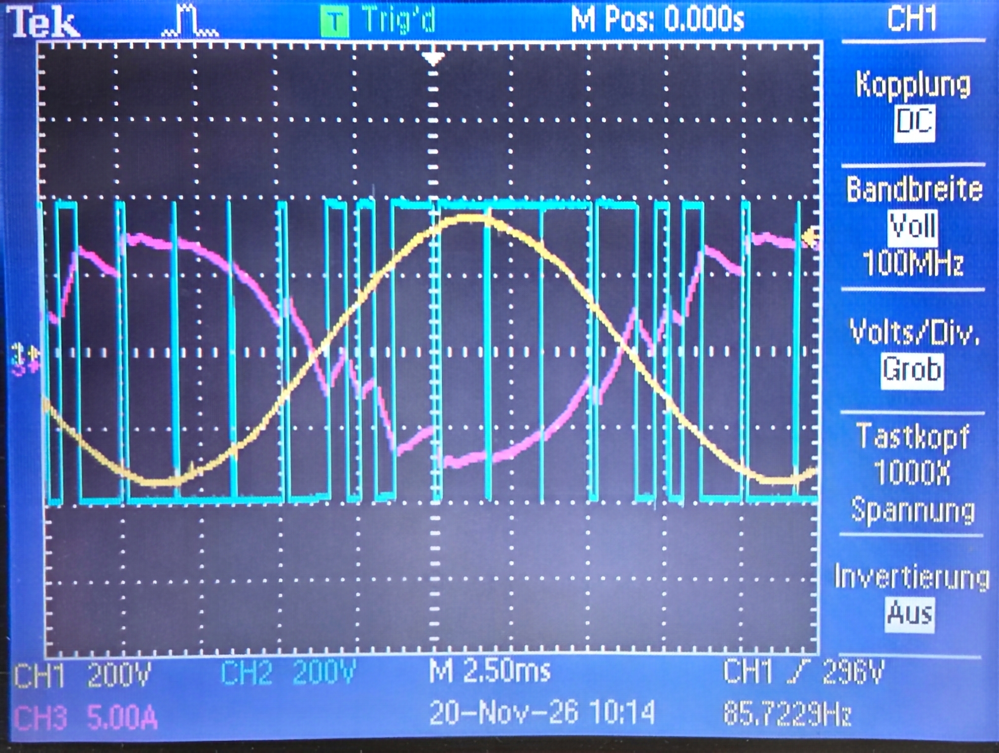
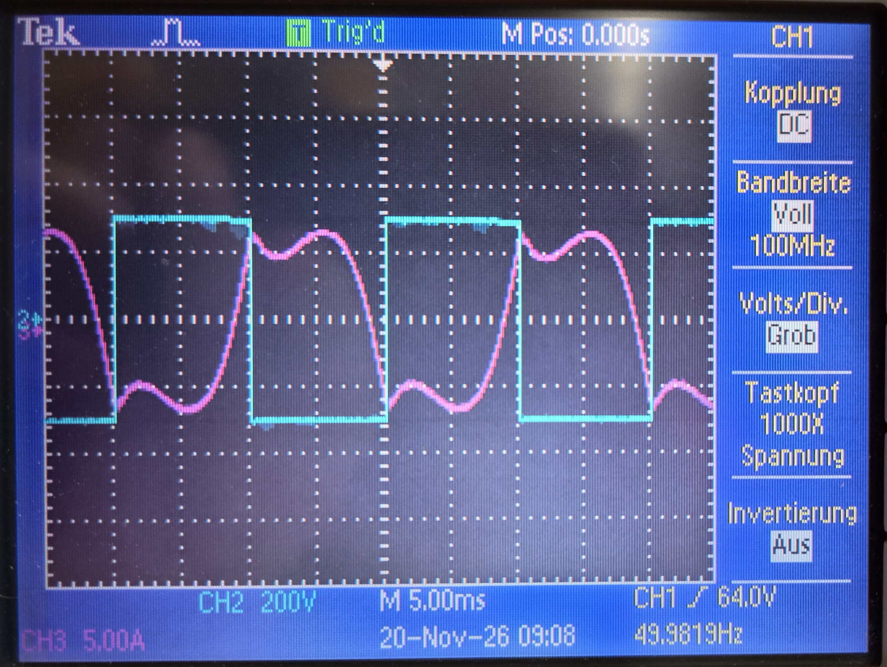
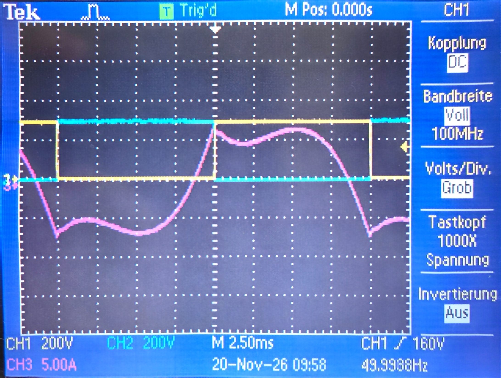

# Messungen WR einphasig – Minimalversion

PM3000 auf **«Netz»**, ausser wo **«WR»** steht.

## 6.1 Rechteck

**6.1.1** θ ≈ 0, Udc so dass I₁ ≈ 0 → Udc = 259 V
- [ ] Oszi-Screenshot u_N, u_WR, i_N

- [ ] Harmonische:

| n | 1 | 3 | 5 | 7 |
|---|---|---|---|---|
| U_n [V] («WR») | 233.3V| 33.42% | 19.87% | 14.32% |
| I_n [A] («Netz») |0.827A | 145% | 50.5% | 28.42% |

**6.1.2** θ variieren (Udc = 258.7 V)

| θ [°] | P | Q | P₁ | Q₁ | I₃ |
|---|---|---|---|---|---|
| −20 |-1.0575 kW |480.7 var | | | |
| −10 | -660 W | 384,9 var| | | |
| 0 | -210W | 329.5| | | |
| 10 | 240W| 321.9 var | | | |
| 20 | 678W | 360 var| | | |

Udc variieren (θ = 0 °)

| Udc [V] | P | Q | P₁ | Q₁ | I₃ |
|---|---|---|---|---|---|
| 150| -62.63W|1.134kvar | | | |
| 175| -87.68 W|911 var | | | |
| 200| -116 W|670var | | | |
| 225| -150W|476var | | | |
| 250| -192.6 W|340var | | | |
| 275| -234 W|350var | | | |
| 300|-266 W |530 var | | | |
| 325| -298W|720var | | | |
| 350| -320W |258.7 V | | | |

## 6.2 Pulsmuster

**6.2.1** Bei P = 1.15 kW, Q₁ = ~0 – je ein Oszi-Screenshot u_WR + i_N
- 282 V 29.8°

Bei 3,5 elim: i1 = 1.2A
bei fein: 358 und 29.8°
bei grob: 363V und 29.8°

| Muster | U₃ («WR») | U₅ («WR») | I₃ | I₅ |
|---|---|---|---|---|
| Sinus fein | 20%| 10% | 20% | 30%|
| Sinus grob | 30%| 12%| 22%| 10%|
| 3.–5. elim. | 0.5%| 30% | 9%| 7%|

### feine Auflösung

### grobe Auflösung 

### 3, 5 Eliminiert.

**6.2.2** Bestes Muster: **Sinusbewertet, feine Auflösung**

> **Begründung:** Bei der sinusbewerteten PWM mit feiner Auflösung wird mit hoher Trägerfrequenz f_s geschaltet. Die Oberschwingungen der Spannung u_WR liegen deshalb nicht bei tiefen Ordnungen (3, 5, 7 …), sondern in Gruppen um f_s, 2·f_s usw. Die Impedanz der Kopplungsinduktivität wächst mit der Frequenz (X_n = n·ωL), somit gilt für die Stromoberschwingungen I_n = U_n / (n·X). Hochfrequente Oberschwingungen werden stark gedämpft und der Netzstrom wird nahezu sinusförmig. Bei grober Auflösung ist die Schaltfrequenz tiefer, die Oberschwingungen liegen näher an der Grundschwingung und werden weniger gedämpft.
> Die Spannung u_WR bleibt auch bei feiner Auflösung pulsförmig – sauber wird nur der Strom. Der Preis sind höhere Schaltverluste (∝ f_s) und mehr EMV-Störungen.
>
> **Hinweis zur Messung:** In unserer Tabelle 6.2.1 hat «3.–5. eliminiert» die kleinsten I₃ und I₅. Das Muster entfernt genau diese beiden Ordnungen gezielt. Die feine Auflösung zeigt bei U₃/I₅ höhere Werte als erwartet – mögliche Ursache: Übermodulation (Udc an der Grenze), wodurch wieder tieffrequente Oberschwingungen entstehen. Für einen eindeutigen Vergleich sollte THD_I aller Muster verglichen werden.

| θ [°] | P | Q | | Udc [V] | P | Q |
|---|---|---|---|---|---|---|
| −20 | | | | | | |
| 0 | | | | | | |
| 20 | | | | | | |

Bei P = 1.15 kW Gleiche Einstellungen wie bei Pulsmuster

## 6.3 Halbleiter

## 6.4 Drehzahl
Leerlauf: ______ min⁻¹  Volllast: ______ min⁻¹

4.1° und 263 V minimale A auf Messgerät